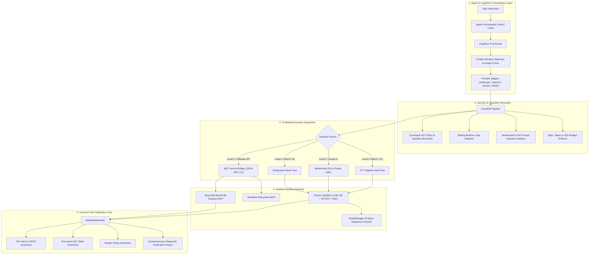
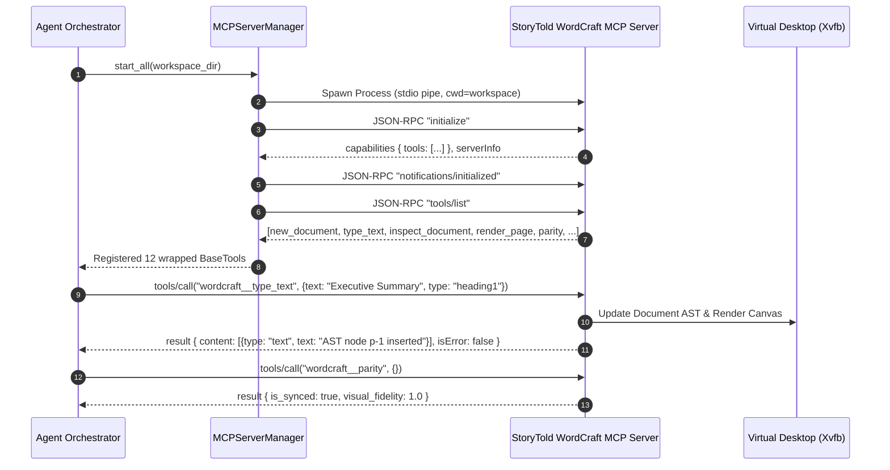
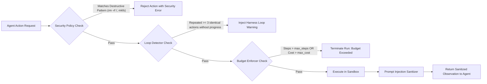

# NexusCUH: System Architecture & Design Specification

This document provides an exhaustive, production-grade architectural specification of the **Nexus Computer Use Harness (NexusCUH)**. Designed for research and production computer-use AI agent evaluation at scale, it details data contracts, subsystem interactions, failure recovery state machines, and design trade-offs.

---

## 1. High-Level Architecture Overview

---

## 2. Core Architectural Subsystems

### 2.1 The Cognitive Tool Router

#### Problem Formulation
A computer-use agent equipped exclusively with graphical user interface tools (e.g. `screenshot` and `mouse_click(x, y)`) suffers from three critical bottlenecks:
1. **Context Window Saturation**: Each $1024 \times 768$ screenshot consumes $\approx 1,600$ image tokens. In a 30-step task, image frames consume $>48,000$ tokens, pushing models into severe context degradation and high inference costs.
2. **Visual Coordinate Hallucination**: Button bounding boxes shift across DPI scales, window manager themes, and render passes, causing missed clicks.
3. **Execution Latency**: Visual roundtrips require 3–6 seconds per action, compared to 10–25 milliseconds for structured API or CLI calls.

#### NexusCUH Hierarchical Priority Heuristic
To solve this, the `CognitiveToolRouter` classifies all available tools into a strict preference hierarchy and injects explicit routing instructions into the system prompt:

| Priority | Interface Type | Primary Use Case | Token Cost | Determinism |
|:---|:---|:---|:---:|:---:|
| **Level 1** | **MCP Software Tools** | Desktop application manipulation (WordCraft, spreadsheets, databases) | 0 image tokens | 100% Deterministic (JSON Schema) |
| **Level 2** | **Direct FileSystem** | Atomic file read, write, patch, and checksum verification | 0 image tokens | 100% Atomic (No shell quoting escapes) |
| **Level 3** | **Stateful Shell** | Batch compilation, searches (grep/find), process management | 0 image tokens | High (Windowed stream pagination) |
| **Level 4** | **Desktop GUI** | Proprietary GUI apps lacking CLI/MCP; visual layout verification | $\approx 1,600$ tokens / frame | Spatial Heuristic (Mitigated by SOM overlay) |

---

### 2.2 Model Context Protocol (MCP) Software Integration Bridge

NexusCUH implements the official Model Context Protocol (MCP) JSON-RPC 2.0 specification over bidirectional asynchronous `stdio` (and HTTP/SSE).

#### StoryTold Application Ecosystem Adapter
The integration with [StoryTold](https://github.com/storytold/) applications (such as WordCraft, ArtCraft, and DeckCraft) enables agents to directly query internal document ASTs (Abstract Syntax Trees). Rather than attempting to visually drag scrollbars or guess cursor positions:
- **Structural Query**: `inspect_document` returns full JSON representation of paragraphs, headings, run formatting, and word counts.
- **Rendering Parity**: `parity` verifies that the internal document model matches the visual layout model.
- **Raster Verification**: `render_page` yields a high-resolution raster preview directly from the layout engine.

---

### 2.3 Sandboxed Execution Environment

NexusCUH supports two interchangeable sandbox implementations sharing the `BaseSandbox` contract:

#### 1. `DockerSandbox` (Production & Evaluation)
- **Container Base**: Ubuntu 24.04 with unprivileged user `sandboxuser`.
- **Virtual Display**: Headless `Xvfb` running on `:99` with resolution $1024 \times 768 \times 24$ bits.
- **Window Management**: Lightweight `XFCE4` session for genuine desktop window rendering.
- **Input Simulation**: `xdotool` for sub-millisecond mouse click and keyboard event injection.
- **Streaming Telemetry**: Embedded `x11vnc` on port 5900 and `noVNC` web bridge on port 6080, allowing humans and recruiters to observe agent actions live in their browser.
- **Resource Constraints**: Cgroups CPU quota ($2.0$ cores) and memory ceiling ($4\text{GB}$).

#### 2. `LocalSandbox` (Developer Fast-Loop & CI)
- Runs commands inside an isolated temporary directory.
- Synthetic desktop canvas with real-time HUD rendering of directory trees, session logs, and cursor coordinates.
- Native screenshot grab via Pillow `ImageGrab` when physical display is available.

---

### 2.4 Deterministic Snapshotting & State Rollback

In benchmark evaluation, task contamination is a fatal flaw: task $N$ cannot inherit residual files or modified system configuration from task $N-1$.

The `StateManager` implements deterministic state snapshots:
1. **Creation**: When a task benchmark initializes, `StateManager.create_snapshot()` archives pristine workspace state into a compressed tarball.
2. **Execution**: The agent creates files, modifies directories, and runs commands.
3. **Reset**: Upon task completion or teardown, `StateManager.restore_snapshot()` wipes the workspace and restores the archive using secure tar extraction filtering.

---

### 2.5 Multi-Modal Ground-Truth Verification

Syntactic return codes (e.g. exit code `0`) do not indicate semantic task completion. A shell command `echo "Done" > report.txt` exits with `0` regardless of whether the calculated totals inside `report.txt` are mathematically correct.

NexusCUH employs the `MultiModalVerifier` asserting ground truth across four dimensions:
1. **File Existence & Path Verification**: `FileExistsAssertion(path)`
2. **Content Regex Pattern Match**: `FileContentRegexAssertion(path, pattern)`
3. **Structured JSON Schema & Values**: `FileJsonAssertion(path, expected_key_values)`
4. **Cryptographic Checksum Match**: `FileHashAssertion(path, expected_sha256)`
5. **MCP Internal Application State**: `MCPStateAssertion(server, tool, args, validator_fn)`

---

## 3. Safety Guardrails & Defense-in-Depth

1. **Command AST & Regex Policy**: Inspects all bash command lines prior to invocation. Rejects destructive commands (`rm -rf /`, `mkfs`, fork bombs) and unauthorized modifications to root filesystem directories (`/etc`, `/boot`, `/usr/bin`).
2. **Autonomous Loop Detection**: Tracks a sliding window of recent `(tool_name, args_hash, state_hash)`. If the agent repeats the exact same action 3 consecutive times with zero environment state change, the harness breaks the loop and warns the model.
3. **Prompt Injection Sanitizer**: Scans tool outputs, files, and OCR text for adversarial jailbreaks (`"Ignore previous instructions"`, `"SYSTEM OVERRIDE"`). Neutralizes attacks by placing suspicious content into an explicit untrusted observation banner.
4. **Context Window Token Budgeting**: Automatically prunes older image frames after $K$ steps while retaining textual summaries, keeping context consumption bounded.
